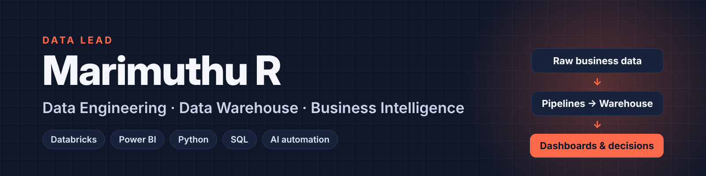

## Hi, I'm Mari 👋

**Data Lead** for a real estate business in Texas. I own the data platform end to end: the
pipelines that bring data in, the data warehouse that organises it, and the Power BI reports and
dashboards the business uses to make decisions every day. 2+ years in data engineering and
analytics, now building on **Databricks**.

<p>
  
  
  
  <a href="https://www.linkedin.com/in/zeb-mari"></a>
</p>

### 🏗️ What I do

- **Data pipelines:** bring data from business systems into one reliable place, on schedule.
- **Data warehouse:** model and maintain the tables the whole business reports from.
- **BI and dashboards:** Power BI reports that leadership actually uses.
- **Databricks:** building the platform, plus exploring Genie, AI/BI dashboards and Databricks Apps.
- **Automation:** Python and AI (Claude) to remove manual reporting work.

### 🧰 Tech stack


### 🚀 Featured projects

| Project | What it does | Tech |
|---|---|---|
| [**ecommerce-weekly-briefing**](https://github.com/M-Aadhi/ecommerce-weekly-briefing) | Combines Shopify-style sales and Meta/Google Ads data, calculates weekly KPIs, flags problems (ROAS below target, refund spikes) and writes a management briefing to Slack, every Monday. | Python · pandas · GitHub Actions · Slack |
| [**linkedin-data-skills**](https://github.com/M-Aadhi/linkedin-data-skills.) | Claude AI skills for a data professional's LinkedIn: profile review, post writing, scheduling. Every post is approved by a human first. | Claude · Python · Publora API |
| [**Anime-Ratings-Analysis-PowerBI**](https://github.com/M-Aadhi/Anime-Ratings-Analysis-PowerBI) | Interactive Power BI analysis of anime ratings. | Power BI |
| [**game-review-sentiment-analysis**](https://github.com/M-Aadhi/game-review-sentiment-analysis) | Sentiment analysis on game reviews. | Python · NLP |
| [**MOVIE-RATING-PREDICTION**](https://github.com/M-Aadhi/MOVIE-RATING-PREDICTION) | Predicts movie ratings with machine learning. | Python · scikit-learn |

### 🔭 Right now

- Bringing **Databricks Genie** and **AI/BI dashboards** to business users
- Writing on LinkedIn about data, Databricks and automation
- Learning: Databricks Apps, data quality and governance

### 📊 GitHub activity

<p>
  
  
</p>

### 🤝 Connect

[](https://www.linkedin.com/in/zeb-mari)
[](https://leetcode.com/u/M-Aadhi)
[](https://www.hackerrank.com/profile/ezioabaddon)

<details>
<summary>🎮 Off the clock</summary>

```python
class Mari:
    location = "Coimbatore, Tamil Nadu"
    hobbies = ["Valorant", "Anime", "Manga", "Chasing that ONE bug at 2 AM"]
    ambitions = ["Learn Japanese", "Stay at peace", "Live with no regrets"]
```
</details>

<p align="center">
  
</p>

<p align="center"><i>There are 10 types of people in the world: those who understand binary and those who don't.</i></p>
